<div align="center">

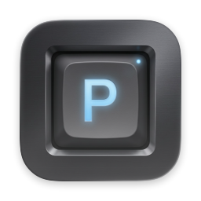

# PrimeType

**基于 Rime 引擎的 macOS 原生质感中文与语音输入法**

[](https://github.com/HeLongaa/PrimeType)
[](https://rime.im/)
[](https://github.com/HeLongaa/PrimeType)
[](https://www.gnu.org/licenses/agpl-3.0.en.html)

</div>

PrimeType 是一个面向 macOS 的开源中文输入法，底层使用 `librime` 处理拼音与词库，前端直接调用系统原生候选框与 `NSGlassEffectView` 材质。

我写它的初衷很简单：鼠须管（Squirrel）足够纯粹，但配置 YAML 门槛高、候选框缺乏原生卷轴和深浅色自适应；商业输入法功能齐全，但常驻内存动辄几百兆且不够透明。PrimeType 试图在两者之间找一个平衡——**常驻内存约 30 MB，开箱即用，同时补齐语音听写、V 模式工具箱、AI 划词翻译与图文剪贴板。**

---

## 下载与安装

### 方式一：直接下载安装包（推荐）

前往 [GitHub Releases](https://github.com/HeLongaa/PrimeType/releases/latest) 下载最新的 `PrimeTypeInstaller-v*.zip`，解压后双击 `PrimeTypeInstaller.app`：

1. 点击「安装」并输入管理员密码，自动将 `PrimeType.app` 安装至 `/Library/Input Methods/`；
2. 随后自动进入 4 步图形化引导向导，依次完成「添加输入法」「麦克风权限」「语音快捷键」与「辅助功能权限」配置；
3. 后续可在「Prime 输入法设置 → 更新」中一键检查并自动更新软件与词库。

> **提示**：
> - 首次全新安装后，如果个别之前已经打开的应用（如 Chrome、VS Code、Electron 类应用）暂时无法切换或输入，重启一次该应用即可正常使用；后续通过应用内自动更新升级无需重启。
> - 由于开源版暂未使用付费 Apple 开发者签名，主程序版本升级后需在系统设置中重新勾选一次辅助功能权限（应用会自动清理失效的旧记录并弹出引导卡片）；词库在线更新不受影响。

### 方式二：从源码编译

#### 环境要求

* macOS 14.0+（macOS 26+ 启用原生 `NSGlassEffectView` 液态玻璃效果）
* Xcode 16.0+ 与 `xcodegen`（`brew install xcodegen`）

#### 构建步骤

```bash
git clone https://github.com/HeLongaa/PrimeType.git
cd PrimeType
./scripts/install.sh
```

---

## 核心特性

### 1. 原生候选框与宿主深浅色自适应

直接渲染系统级候选样式与网格卷轴展开（按 `Tab` 或 `↓` 展开）。

除了跟随系统外观，PrimeType 会实时检测当前输入焦点所在窗口的实际色彩主题。当系统处于浅色模式、而你在暗色主题的 VS Code 或终端里输入时，候选框会自动切换为深色外观。

| 浅色外观 | 深色外观 |
| :---: | :---: |
| 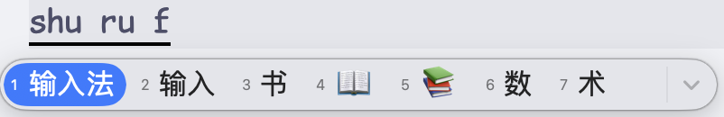 | 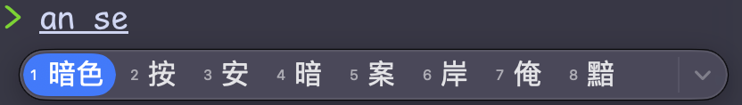 |

<div align="center">
  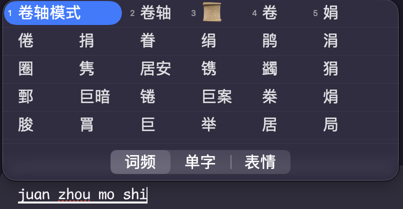
  <br/>
  <sub>多行卷轴展开与候选过滤</sub>
</div>

### 2. 开箱即用的可视化设置与多词库共享

不需要手写 YAML 配置文件，所有常用选项均可在设置面板中直接调整：

* **三大词库一键切换**：内置 **雾凇拼音 (`rime-ice`)**、**万象拼音 (`rime_wanxiang`)**、**薄荷拼音 (`oh-my-rime`)**。三套方案共享同一份个人词频与自造词库（`prime_shared.userdb`），切换词库不会丢失输入习惯。
* **增量热更新**：支持在设置内检查 GitHub 上游词库更新，通过用户目录覆盖层热加载，不破坏应用签名。
* **输入细节优化**：数字后符号自动转半角（如 `12:00`、`3.14`）、回车递增列表序号（`1.` → `2.`）、成对标点自动补全并移入光标、中英文混排自动加空格、邮箱与网址智能补全。

| 基础输入设置 | 词库切换与在线更新 |
| :---: | :---: |
| 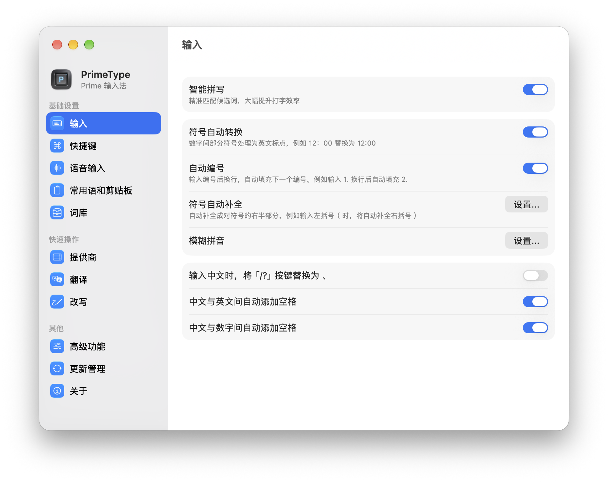 | 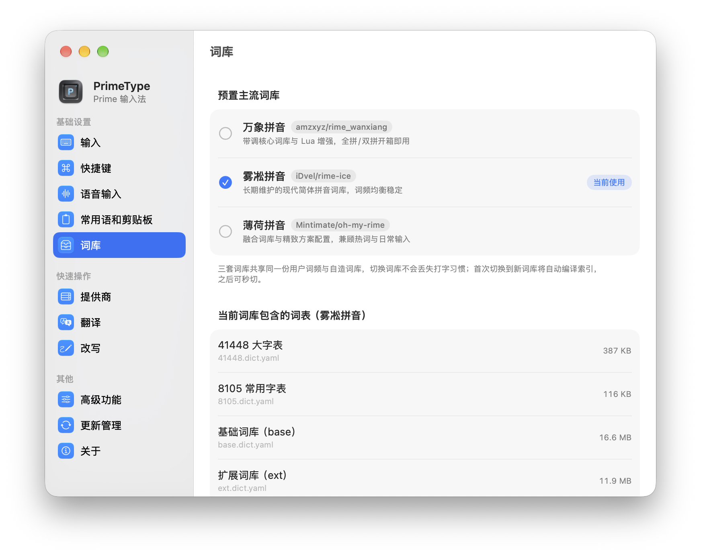 |

### 3. 低延迟流式语音输入

基于 CoreAudio HAL 音频采集与 `libopus` 编码，支持点按听写与按住说话（Push-to-Talk）两种模式：

* **多渠道免配置可用**：内置豆包、微信、千问、Chatterfly 四条免登录流式识别通道，以及八哥说（有道）账号通道。
* **按键预录与热麦**：支持后台麦克风常驻预热与内存 Pre-Roll 缓冲，按下快捷键瞬间开始采集，避免首字吞音；说话期间文字实时流式上屏，松手后自动补全标点。
* **录音自动压低媒体音量**：说话期间按比例降低系统媒体播放音量，结束后自动恢复。

| 语音输入悬浮胶囊 | 识别通道与触发设置 |
| :---: | :---: |
| 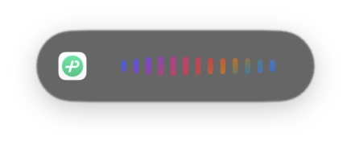 | 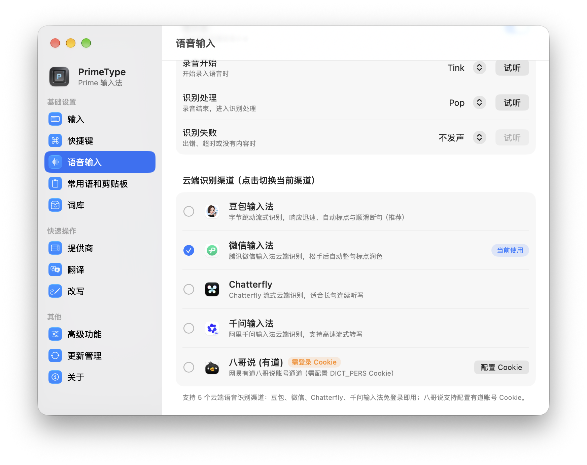 |

### 4. 「V 模式」快捷工具箱

在中文状态下按 `v` 键即可在光标旁呼出快捷面板（若继续输入 `vivo`、`vue` 等英文单词或按回车，会自动退出并原样上屏）：

* **算式计算与大写转换**：输入 `v128*6+50` 实时计算并给出人民币大写候选；输入纯数字（如 `v2026`、`v8`）可快速转换为中文大写数字及带圈/括号序号。
* **常用信息与符号**：支持 `vj` 剪贴板、`vc` 常用语、`vy` 语音、`ve` 490+ 分类符号面板、`vf` 翻译、`vr` 改写、`vd` 日期时间、`vs` 设置。

| V 模式主菜单 | 实时计算与数字转换 |
| :---: | :---: |
| 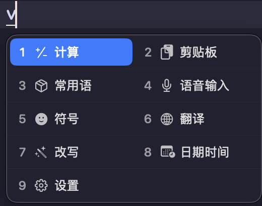 | 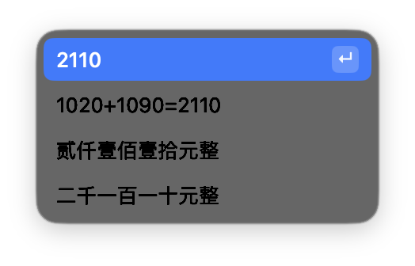 |

### 5. AI 翻译与润色改写

支持配置任意 OpenAI 兼容接口（OpenAI、DeepSeek、OpenRouter、本地 Ollama 等），可管理多个服务商并拉取模型列表：

* **选中或直接触发**：选中屏幕上的任意文本，或在输入框内刚打完一段话（无需手动全选），双击修饰键即可在光标旁弹出结果。
* **自动语种识别与逐词 Diff**：自动判断原文语种占比并在设定的双语间互译；润色改写模式会以删除线/高亮标出修改差异，按 `↵` 直接替换原文，`⌘C` 复制。

| 智能双向翻译 | 润色改写与 Diff 对比 |
| :---: | :---: |
| 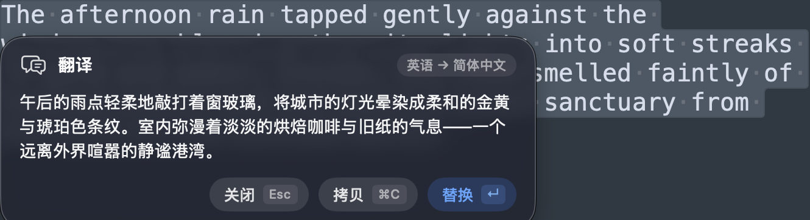 | 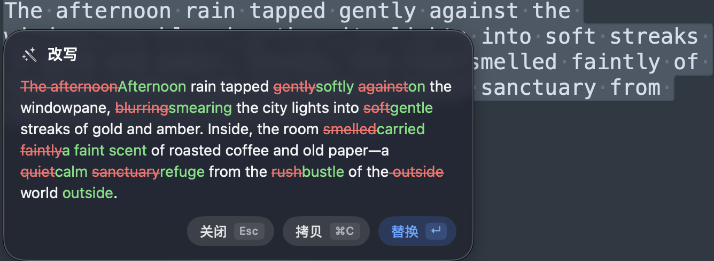 |

### 6. 图文剪贴板与常用语

* **独立剪贴板面板**：默认 `⌥ ⇧ V` 呼出，记录纯文本、图片（支持缩略图与高清预览）、链接与文件，支持按应用来源搜索及自动清理周期设置。文本与链接优先走 InputMethodKit 通道直接上屏，无需额外辅助功能权限。
* **拼音首字母触发常用语**：添加地址、邮箱或常用回复后，输入前 3 个字的拼音首字母（如「云南省…」输入 `yns`）即可置顶候选，支持一键导入 macOS 系统文本替换。

| 剪贴板历史窗口 |
| :---: |
| 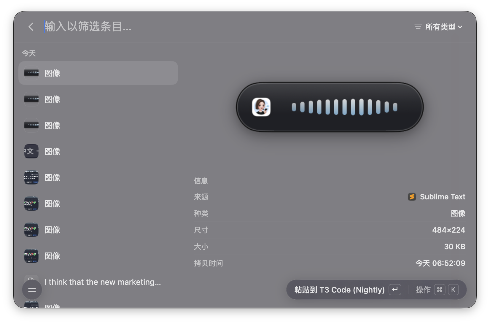 |

---

## 社区

感谢 [LINUX DO](https://linux.do/) 社区提供开放、友善的技术交流平台。

---

## 开源许可

本项目采用 [GNU AGPL-3.0](LICENSE) 许可证开源。第三方组件及词库许可详见 [THIRD_PARTY_NOTICES.md](THIRD_PARTY_NOTICES.md)。
